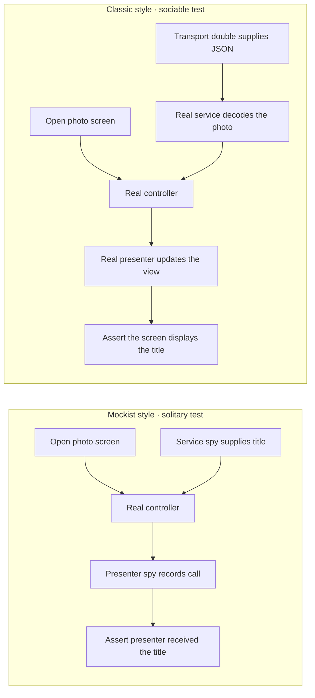

# Sociable TDD

**Fast feedback and shareable tests for agentic coding.**

A test earns its place when it catches a regression you care about. A test that only checks which helper was called can fail during a safe refactor and still pass when the feature breaks. Every such test adds code that people and agents have to maintain.

Sociable TDD is a language-neutral skill that guides coding agents through Red, Green, and Refactor. Start with behavior a caller or user can observe. Let real components work together where they can run quickly and reliably. Fast tests shorten the feedback loop, and stable assertions let people and agents share the same suite as the code evolves.

## What makes a test sociable?

A sociable test lets real collaborators work together. It uses a test double when a dependency makes feedback slow, unreliable, or hard to isolate between tests. This is common in **classic** or **classical** TDD, often associated with the **Chicago school**. Fowler also uses **Detroit** for the classical style. **Mockist** TDD, associated with the **London school**, favors **solitary tests** that replace collaborators with test doubles and often verify how they interact. [Fowler on sociable and solitary tests](https://martinfowler.com/bliki/UnitTest.html) · [Fowler on classical and mockist TDD](https://martinfowler.com/articles/mocksArentStubs.html) · [Cooper on the London and Chicago schools](https://www.youtube.com/watch?v=vOO3hulIcsY&t=178s)

## Solitary and sociable tests in the photo app

Both variants open a screen that fetches a photo and should display its title. Here is what each controller test exercises.

## Why use sociable tests?

- **Refactor with less test churn.** Passing a `Photo` instead of a title string changes an internal handoff. In this demo, that change would affect three mockist test files and two spies. The sociable test can keep the same response and title assertion.
- **Catch failures between real components.** The sociable test exercises decoding, presentation, and rendering together. A presenter spy can record the expected call even if the real presenter would fail to display the title.
- **Maintain fewer doubles.** Keep real collaborators where they are fast and predictable. The demo stubs the transport so the tests run without network access.
- **Spend less time rewriting tests.** Tests at the public interface can often stay as written through a refactor. People and agents can rerun the suite and get back to the feature or bug fix sooner.
- **Spend fewer tokens on test maintenance.** Fewer fixtures and mock expectations mean less test setup for an agent to read and fewer edits for it to generate.

## Install and use

Copy the entire [`skills/sociable-tdd`](skills/sociable-tdd/) directory into your project's `.agents/skills/` for Codex or `.claude/skills/` for Claude Code. Keep `SKILL.md` and its `references/` directory together. This installs the skill and its guides. The Swift demo is available separately in this repository.

In Codex, start a prompt with `Use $sociable-tdd to…`. In Claude Code, invoke `/sociable-tdd` and describe the behavior you want to add or fix.

> Add a missing-photo message to the details screen. Show that the test fails for the expected reason before changing production code.

## Explore the photo app

The Swift demo has two variants of the same screen. The classic test checks the title displayed to the user. The mockist controller test checks calls between collaborators. The [walkthrough](skills/sociable-tdd/references/photo-app.md) shows what happens to both tests when the service starts passing a `Photo` instead of a title string.

Open [ExampleApp.xcodeproj](examples/PhotoApp/ExampleApp.xcodeproj/) in Xcode 27.2, select an iOS Simulator and either the `ClassicStyleApp` or `MockistStyleApp` scheme, then press Command-U to run its Swift Testing suite.

## Further reading

- Ian Cooper’s [TDD, Where Did It All Go Wrong?](https://www.youtube.com/watch?v=EZ05e7EMOLM) and [TDD Revisited](https://www.youtube.com/watch?v=vOO3hulIcsY)
- Kent Beck’s [Canon TDD](https://newsletter.kentbeck.com/p/canon-tdd)
- Martin Fowler’s [Unit Test](https://martinfowler.com/bliki/UnitTest.html) and [Test Double](https://martinfowler.com/bliki/TestDouble.html)
